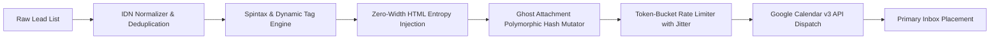

<div align="center">


# CalGrid

### High-Deliverability Windows Scheduler & Batch Dispatcher for Google Calendar Outreach

[](https://docs.vib.tools/calgrid)
[](docs/getting-started/system-requirements.md)
[](https://docs.vib.tools/calgrid)
[](https://vib.tools/calgrid)

<p align="center">
  <b>Scale your calendar outreach with zero spam flags, polymorphic Drive attachments, multi-workspace tabs, and enterprise inbox delivery.</b>
</p>

[📖 Live Docs Portal](https://docs.vib.tools/calgrid) • [🚀 Quick Start](docs/getting-started/index.md) • [⚡ Dispatch Modes](docs/guides/dispatch-modes.md) • [🛡️ Anti-Spam Engine](docs/settings/application-settings.md#advance-settings) • [❓ Support & FAQ](docs/help/faq.md)

---

</div>

## ⚡ Overview & What is CalGrid?

**CalGrid** is a high-performance Windows desktop client designed specifically for marketing teams, outreach specialists, and event coordinators who need to send personalized Google Calendar invitations at scale without hitting Google anti-spam triggers or account suspensions.

Built on **Python 3.12** and **PySide6 (Qt)**, CalGrid operates completely asynchronously with zero UI freezing, storing OAuth secrets strictly in **Windows Credential Manager** and sensitive recipient text via **DPAPI encryption**.

```
┌─────────────────────────────────────────────────────────────────────────────────┐
│                               CalGrid Desktop UI                                │
├─────────────────────────────────────────────────────────────────────────────────┤
│ [Workspace 1: Tech Leads] [Workspace 2: Enterprise Outreach] [+]               │
├─────────────┬─────────────────────────────────────┬─────────────────────────────┤
│ 👤 Account  │ 📅 Event Details                    │ 👥 Recipients & Slicing     │
│  OAuth2     │  • Title with Spintax Tags          │  • CSV / Excel Bulk Import  │
│  Switchable │  • Smart Slot Staggering            │  • Real-Time Deduplication  │
│             │  • Dynamic Zero-Width Entropy       │  • IDN / Punycode Support   │
├─────────────┼─────────────────────────────────────┼─────────────────────────────┤
│ 🛡️ Mode     │ 📁 Google Drive Ghost Attachments   │ 📊 Live Dispatch Engine     │
│  [Safe]     │  • Round-Robin File Pool            │  • Progress: ████████ 85%   │
│  [Normal]   │  • Polymorphic Hash Mutations       │  • Rate Limiter & Backoff   │
│  [Fast]     │  • Zero-Width Title Entropy         │  • Live Audit Log Stream    │
│  [Ultra]    │  • 100MB File Size Guard            │  • Instant Pause / Resume   │
└─────────────┴─────────────────────────────────────┴─────────────────────────────┘
```

---

## 🌟 Key Features

| Capability | What It Does | Why It Matters |
|---|---|---|
| **Multi-Workspace Engine** | Independent campaign tabs with isolated accounts, queues, and states. | Run parallel campaigns for multiple brands without cross-contamination. |
| **Zero-Spam Deliverability** | Humanized jitter, slot staggering, spintax variations, and entropy injection. | Maximizes primary inbox placement and protects Google sender reputation. |
| **Ghost Drive Pools** | Uploads multiple unique copies of attachments with byte-level polymorphic mutations. | Prevents Google Drive anti-abuse filters from flagging duplicated files. |
| **Zero-Width Invisible Entropy** | Injects invisible Unicode tokens into descriptions and attachment titles. | Makes every single outgoing invite cryptographically unique to scanners. |
| **Enterprise Grade Security** | Refresh tokens stored in **Windows Credential Manager**; DPAPI-encrypted states. | Zero plaintext credentials or leaked OAuth keys on disk. |
| **Resilient Concurrency** | Dedicated background worker daemon threads communicating via Qt Queued Signals. | Fluid, responsive 60 FPS user interface even during thousands of API calls. |

---

## 🚀 Quick Navigation & Documentation Suite

Explore the comprehensive CalGrid documentation suite hosted live on [docs.vib.tools/calgrid](https://docs.vib.tools/calgrid):

```
docs/
├── 🔰 getting-started/       Installation, Windows setup, license activation, OAuth
├── 🧭 guides/                Interface, workspace tabs, Drive files, debug diagnostics
├── 🔄 workflows/             First campaign walkthrough, parallel sends, bulk imports
├── ⚙️ settings/              Rate limits, batch sizes, retry delays, reminder alerts
└── 💡 help/                  Troubleshooting guides, FAQs, and API quota boundaries
```

### 📚 Section Breakdown

<details open>
<summary><b>1. Getting Started</b></summary>
<br>

- [**System Requirements**](docs/getting-started/system-requirements.md) — Windows 10/11 x64, Python 3.12, memory specs.
- [**Installation Guide**](docs/getting-started/installation.md) — Step-by-step setup and environment configuration.
- [**First-Time Setup**](docs/getting-started/first-time-setup.md) — License key validation and first boot.
- [**Google API & OAuth Setup**](docs/getting-started/google-api-setup.md) — Creating Google Cloud credentials and scopes.

</details>

<details>
<summary><b>2. Feature Guides</b></summary>
<br>

- [**Interface Overview**](docs/guides/interface-overview.md) — Complete visual map of every window element.
- [**Workspace Tabs**](docs/guides/workspace-tabs.md) — Tabbed multi-campaign lifecycle management.
- [**Google Authentication**](docs/guides/google-auth.md) — Account authorization and token caching.
- [**Event Configuration**](docs/guides/event-details.md) — Custom titles, dates, Meet links, and HTML messages.
- [**Recipients Management**](docs/guides/receivers.md) — CSV/Excel import, normalization, and deduplication.
- [**Drive Attachments**](docs/guides/attachments.md) — Ghost file pools, hash mutation, and sharing permissions.
- [**Template Tags & Spintax**](docs/guides/template-tags.md) — Dynamic tags (`{name}`, `{company}`, `{date}`) and `{spin|tax}`.
- [**Dispatch Modes**](docs/guides/dispatch-modes.md) — Profile comparison: Safe, Normal, Fast, and Ultra.
- [**Diagnostics & Debugging**](docs/guides/debug-dialog.md) — In-app API inspector, retry monitor, and log viewer.

</details>

<details>
<summary><b>3. Practical Workflows</b></summary>
<br>

- [**Sending Your First Campaign**](docs/workflows/sending-first-campaign.md) — Full end-to-end tutorial from blank canvas to dispatch.
- [**Bulk Recipient Import**](docs/workflows/bulk-import.md) — Cleanly ingest thousands of leads without invalid email errors.
- [**Multi-Workspace Parallel Campaigns**](docs/workflows/multi-workspace.md) — Operating 5+ workspaces simultaneously.
- [**Personalized Messaging**](docs/workflows/personalized-invites.md) — Crafting high-converting unique invitations.

</details>

<details>
<summary><b>4. Settings & Architecture</b></summary>
<br>

- [**Settings Reference**](docs/settings/application-settings.md) — Calendar, Rate limits, Invites, Advance, and App settings.
- [**Rate Limiter & Backoff**](docs/settings/application-settings.md#rate-settings) — Token-bucket pacing and exponential backoff.
- [**Advance Anti-Spam Safeguards**](docs/settings/application-settings.md#advance-settings) — Human jitter, slot staggering, and entropy.

</details>

<details>
<summary><b>5. Help & Troubleshooting</b></summary>
<br>

- [**Troubleshooting Guide**](docs/help/troubleshooting.md) — Diagnostic steps for OAuth, deliverability, and connection errors.
- [**Frequently Asked Questions (FAQ)**](docs/help/faq.md) — Quick answers to the most common user inquiries.
- [**Platform Limitations**](docs/help/limitations.md) — Google Workspace sending quotas, API limits, and rate ceilings.

</details>

---

## 🛡️ Anti-Spam Engine & Deliverability Architecture

CalGrid solves the #1 challenge in batch calendar outreach: **spam detection algorithms**.



1. **Invisible Entropy Tokens:** Appends randomized zero-width non-joiners (`\u200C`, `\u200D`, `\uFEFF`) inside HTML tags, ensuring every payload has a distinct SHA-256 fingerprint.
2. **Polymorphic Drive Files:** Generates distinct ghost copies of attachments by varying invisible trailer bytes, preventing Google Drive file duplicate warnings.
3. **Slot Staggering:** Disperses invitation times across a randomized calendar window rather than clustering 500 invites at the exact same second.

---

## 💻 Tech Stack & Specifications

- **OS Compatibility:** Windows 10 (Build 19041+) / Windows 11 (64-bit)
- **GUI Engine:** PySide6 (Qt 6 Widgets) with custom responsive dark presentation tokens
- **Runtime:** Python 3.12 (CPython x64)
- **API Engine:** Google Calendar v3 REST API, Google Drive v3 REST API
- **Security:** Windows Credential Manager (`keyring`), Windows DPAPI encrypted storage
- **Documentation Engine:** [Vib Docs Engine](https://docs.vib.tools/vib-docs-engine) (Astro + Starlight Content Collections)

---

## 🤝 Support & Resources

- 🌐 **Documentation Hub:** [https://docs.vib.tools/calgrid](https://docs.vib.tools/calgrid)
- 🏢 **Organization:** [https://github.com/vibdocs](https://github.com/vibdocs)
- 💬 **Issue Tracking:** Built-in **🐛 Report** button inside the CalGrid bottom status bar.

---

<div align="center">

**CalGrid** is a registered proprietary product of **Vib Tools Workspace**.  
*Designed for privacy, deliverability, and scale.*

© 2026 Vib Tools. All rights reserved.

</div>
